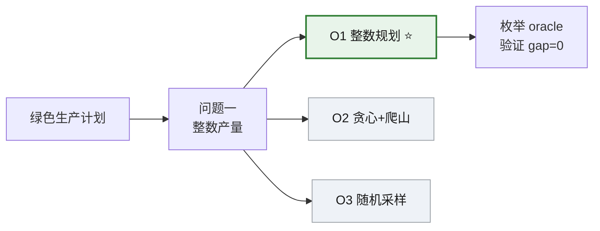

# 建模方案决策板 · 第 2 轮（已确认）

> **确认码：508F**
>
> 运行 `python tools/design_board.py confirm --workspace . --apply` 时需要输入上面这 4 位确认码。AI 不得代跑此命令、不得代填此码。
>
> **问题**：绿色生产计划 — 在工时 120h、材料 160kg、碳排 70kg 上限内，确定 A/B 产品非负整数产量，使总利润最大。
> **状态**：✅ 已于 2026-10-19 22:10 由用户确认（回执来源：browser-submit）
> **变更摘要（相比第 1 轮）**：无改动（本列为"无修改"第 2 轮，达到确认条件）
> **第 1 轮改了什么**：把问题一的选择从 O2 贪心改为 O1 整数规划，并新增批注"要求给出 LP 松弛下界和 gap"。

---

## 一、结论速览

| 小问 | 选定方案 | 一句话理由 |
|---|---|---|
| 问题一 | **O1 整数线性规划（枚举）** | 可行域仅 1071 个整点，毫秒级枚举即可**证明**全局最优，gap = 0 |

---

## 二、模型结构总览

> 读法：从左到右是"题目 → 小问 → 候选模型"，最右侧是验证方式。绿色 = 已选用，灰色 = 未选用。

---

## 三、待你决定（0 项）

本问题已确认，无待决项。

历史：第 1 轮你做的选择（点击展开）

| 项 | 第 1 轮默认 | 你的选择 | 你的批注 |
|---|---|---|---|
| 问题一采用哪个模型 | O2 贪心 + 爬山 | **O1 整数规划** | 用 O1，但要求给出 LP 松弛下界和 gap，方便写论文时说明最优性 |

---

## 四、候选方案对比（这是做决策的地方）

| 方案 | 一句话理由 | 适用条件 | 复杂度/实测耗时 | 需要的数据 | 主要风险 | 试算结果（真实计算） | 推荐度 |
|---|---|---|---|---|---|---|---|
| **O1 整数线性规划（枚举）** ⭐ | 可行域小，可证明全局最优 | ✅ 变量整数、约束线性 | O(1071 整点) / **4.27 ms** | 仅题目参数 | 规模上到 1e5 需换求解器 | **objective = 2175**（x_a=20, x_b=25），LP 下界 2175，**gap = 0** | 🟢 推荐 |
| O2 贪心 + 爬山 | 实现最简单、可解释 | ⚠️ 无最优性保证 | O(n) / **0.037 ms** | 仅题目参数 | 局部最优，评委追问 gap 无法回答 | objective = 2120（x_a=53, x_b=0），**差 2.53%** | ⚪ 备选 |
| O3 随机采样 100 | 无须建模，快速探量级 | ❌ 无最优性保证 | O(N) / **4.24 ms** | numpy | 结果随种子变，不可复现为"最优" | objective = 2170（x_a=24, x_b=22），**差 0.23%** | ⚪ 备选 |

**怎么读这张表**：
- **推荐度**：🟢 推荐 / 🟡 需确认 / ⚪ 备选 / ⛔ 不推荐。颜色只表达状态，不代表评分高低。
- **试算结果**列是**真实跑出来的**，不是估计。复跑命令：`python solution.py --method enum|greedy|sample`。
- **适用条件**列用 ✅/⚠️/❌ 标记是否满足本题。

---

## 五、已锁定（AI 不得推翻）

| 项 | 选择 | 来源 | 备注 |
|---|---|---|---|
| 编程语言 | Python | 第 0 轮确认 | — |
| 问题一模型 | O1 整数线性规划 | 第 1 轮用户选择 | `user_locked: true` |
| 必须输出 | LP 松弛下界 + optimality gap | 第 1 轮用户批注 | 写进论文"最优性说明"一节 |

---

## 六、未解决的题意歧义（需你留意）

| ID | 严重度 | 问题 | 当前处理 |
|---|---|---|---|
| A2 | 🟡 medium | 碳排上限 70 kgCO2 是全周期总量还是单位时间？ | **暂按全周期总量处理**，会在 assumption_ledger 记为 H2。若你确认是单位时间，需要重算 |

> A1（是否允许只生产一种产品）已解决：允许，非负整数天然包含 0。

---

## 七、评审风险预演（提前想好怎么答）

| 评委可能问 | 建议回答要点 | 支撑材料 |
|---|---|---|
| 为什么不用启发式？ | 可行域仅 1071 整点，枚举可**证明**最优；启发式无法回答 gap | `optimization_certificate.json` |
| 这个解是不是碰巧最优？ | 枚举全可行域 + LP 松弛下界 = 2175 = ILP 最优值，gap = 0 | `mini_trials.json` O1 条目 |
| 参数变了怎么办？ | 已做敏感性：A 利润 ±10% → 最优解从 (20,25) 变到 (52,1)，利润 2095/2175/2343 | TBD（Phase 3 补） |
| 碳排约束是硬约束还是可交易？ | 当前按硬约束处理，已在假设台账说明 | `assumption_ledger.md` H2 |

---

## 八、来源速查（默认折叠，避免淹没正文）

三个候选的方法卡出处与可信度分级（点击展开）

| 方案 | 方法卡 | 来源比赛 | 年份 | tier | 可核验链接 |
|---|---|---|---|---|---|
| O1 | OPT-01 线性规划基线 | 高教社杯 CUMCM | 2024 | tier_a | [国赛论文展示入口](https://dxs.moe.gov.cn/zx/hd/sxjm/sxjmlw/qkt_sxjm_lw_lwzs.shtml) |
| O2 | OPT-02 整数规划与启发式修复 | MathorCup | 2023 | tier_a | [mathorcup.org](https://www.mathorcup.org/) |
| O3 | OPT-03 多阶段调度（仅借用采样思想） | 研究生赛 NPMCM | 2022 | tier_b | [cpipc.acge.org.cn](https://cpipc.acge.org.cn/cw/hp/4) |

> 说明：以上来源只提供"方法启发"，不复制原作品正文。O3 借用的是"采样估量级"这个思想，不是多阶段调度本身。

---

## 九、下一步

1. ✅ 决策板已确认 → 闸门已开
2. 进入 Phase 1：五视角并行建模（已锁定项注入 prompt，不得推翻）
3. 生成 `final_solution.json` / `model_spec.json` / `optimization_certificate.json`
4. 进入 Phase 3：写代码、跑真实验证、出图

---

本文件由 `design_board.json` 自动渲染生成，**不是**唯一真实来源。修改请改 JSON 或使用 HTML/Excel 视图后由工具回写。
