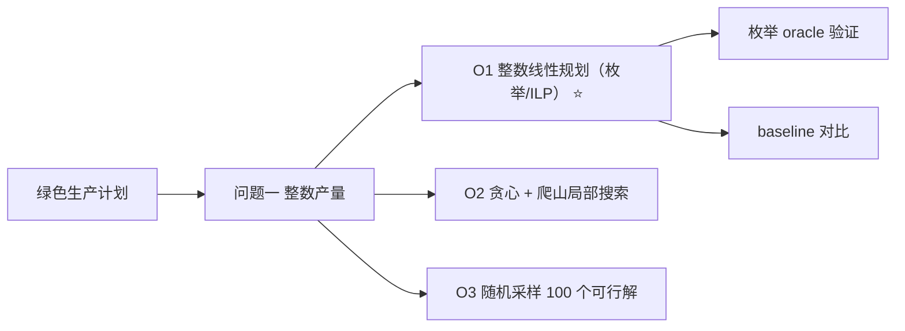

# 建模方案决策板 · 第 2 轮

> **确认码：BE7F**
>
> 运行 `python tools/design_board.py confirm --workspace . --apply` 时需要输入上面这 4 位确认码。
>
> **状态**：✅ 已确认
> **确认信息**：2026-06-28T12:00:00+00:00 · by user
>
> **变更摘要**：第 2 轮无改动（0 项）
>
> **题目**：绿色生产计划：整数产量最大化总利润

---

## 一、结论速览

| 小问 | 选定方案 | 一句话理由 |
|---|---|---|
| Q1 · 确定 A、B 产品非负整数产量，在工时 120h、材料… | **O1 整数线性规划（枚举/ILP）** | 3 个线性约束、2 个整数变量，可行域仅 1071 个整点，枚举即可在毫秒级证… |

---

## 二、模型结构总览

> 导图只读：节点直接来自 `design_board.json` 的 `mindmap.source`；要改结构请改 JSON 后重新 `render`。

---

## 三、待你决定（0 项）

> `- [x]` 标记的是 AI 推荐项（`tier: recommended`），不是你的最终选择；最终选择以 `user_choice` 为准。

### Q1 · 确定 A、B 产品非负整数产量，在工时 120h、材料…

- [x] **O1 整数线性规划（枚举/ILP）**（推荐 ⭐；你当前的选择；已锁定）
  - 理由：3 个线性约束、2 个整数变量，可行域仅 1071 个整点，枚举即可在毫秒级证明全局最优
  - 来源：method_card OPT-01；tier=tier_a；已核验；references/award_playbook.md#方法卡 OPT-01 线性规划基线
  - 试算：样本：全量可行域（1071 个整点）；objective=2175, x_a=20, x_b=25, feasible=true；耗时 0.00427 s；复跑：`python solution.py`
  - 复杂度：O(可行整点数)；本例 1071 个点，实测 4.27 ms
  - 风险：若变量规模增至 1e5 以上，枚举不可行，需换 HiGHS/CBC；评委可能要求给出 LP 下界
  - 依赖：无
- [ ] **O2 贪心 + 爬山局部搜索**（已锁定）
  - 理由：实现最简单、可解释性强，适合作为 baseline
  - 来源：method_card OPT-02；tier=tier_a；已核验；references/award_playbook.md#方法卡 OPT-02 整数规划与启发式修复
  - 试算：样本：全量可行域（贪心路径）；objective=2120, x_a=53, x_b=0, feasible=true；耗时 3.7e-05 s；复跑：`python solution.py --method greedy`
  - 复杂度：O(n)，实测 0.037 ms
  - 风险：被困在局部最优：本例只能到 2120，比最优低 55（2.53%）；无法证明 gap
  - 依赖：无
- [ ] **O3 随机采样 100 个可行解**（已锁定）
  - 理由：无须建模，用于快速估计可行域量级与解的上界范围
  - 来源：method_card OPT-03；tier=tier_b；已核验；references/award_playbook.md#方法卡 OPT-03 多阶段调度（仅借用采样思想）
  - 试算：样本：随机种子 42，采样 100 个可行点；objective=2170, x_a=24, x_b=22, feasible=true；耗时 0.00424 s；复跑：`python solution.py --method sample --seed 42`
  - 复杂度：O(N)，N=100 采样，实测 4.24 ms（含构建可行域）
  - 风险：无最优性保证：本例采样 100 个点最好只到 2170，比最优低 5；无法回答『为什么是这个解』
  - 依赖：numpy

**你的批注**：用 O1，但要求给出 LP 松弛下界和 gap，方便写论文时说明最优性。

---

## 四、候选方案对比

> 这是做决策的地方：先看推荐度与主要风险，再看试算结果是否为真实数值（应附复跑命令）。

### Q1 · 确定 A、B 产品非负整数产量，在工时 120h、材料…

| 方案 | 一句话理由 | 复杂度 | 主要风险 | 试算结果 | 推荐度 |
|---|---|---|---|---|---|
| **O1 整数线性规划（枚举/ILP）** ✅ | 3 个线性约束、2 个整数变量，可行域仅 1071 个… | O(可行整点数)；本例 1071 个点，实测 4.27… | 若变量规模增至 1e5 以上，枚举不可行，需换 HiG… | objective=2175, x_a=20, x_b=25, feasible=true；0… | 🟢 推荐 |
| O2 贪心 + 爬山局部搜索 | 实现最简单、可解释性强，适合作为 baseline | O(n)，实测 0.037 ms | 被困在局部最优：本例只能到 2120，比最优低 55（… | objective=2120, x_a=53, x_b=0, feasible=true；3.… | ⚪ 备选 |
| O3 随机采样 100 个可行解 | 无须建模，用于快速估计可行域量级与解的上界范围 | O(N)，N=100 采样，实测 4.24 ms（含构… | 无最优性保证：本例采样 100 个点最好只到 2170… | objective=2170, x_a=24, x_b=22, feasible=true；0… | ⚪ 备选 |

---

## 五、已锁定（AI 不得推翻）

| 小问 | 锁定项 | 选择 | 备注 |
|---|---|---|---|
| Q1 · 确定 A、B 产品非负整数产量，在工时 120h、材料… | Q1 模型选择 | **O1 整数线性规划（枚举/ILP）** | 用 O1，但要求给出 LP 松弛下界和 gap，方便写论文时说明最优性。 |

---

## 六、来源速查

展开：各候选的来源、tier 与核验状态（默认折叠，避免淹没正文）

| 小问 | 方案 | 来源类型 | 编号 | tier | 已核验 | 备注 |
|---|---|---|---|---|---|---|
| Q1 · 确定 A、B 产品非负整数产量，在工时 120h、材料… | O1 整数线性规划（枚举/ILP） | method_card | OPT-01 | tier_a | ✅ | references/award_playbook.md#方法卡 OPT-01 线性规划基线 |
| Q1 · 确定 A、B 产品非负整数产量，在工时 120h、材料… | O2 贪心 + 爬山局部搜索 | method_card | OPT-02 | tier_a | ✅ | references/award_playbook.md#方法卡 OPT-02 整数规划与启发式修复 |
| Q1 · 确定 A、B 产品非负整数产量，在工时 120h、材料… | O3 随机采样 100 个可行解 | method_card | OPT-03 | tier_b | ✅ | references/award_playbook.md#方法卡 OPT-03 多阶段调度（仅借用采样思想） |

---

本文件由 design_board.json 渲染生成，不是唯一真实来源。
