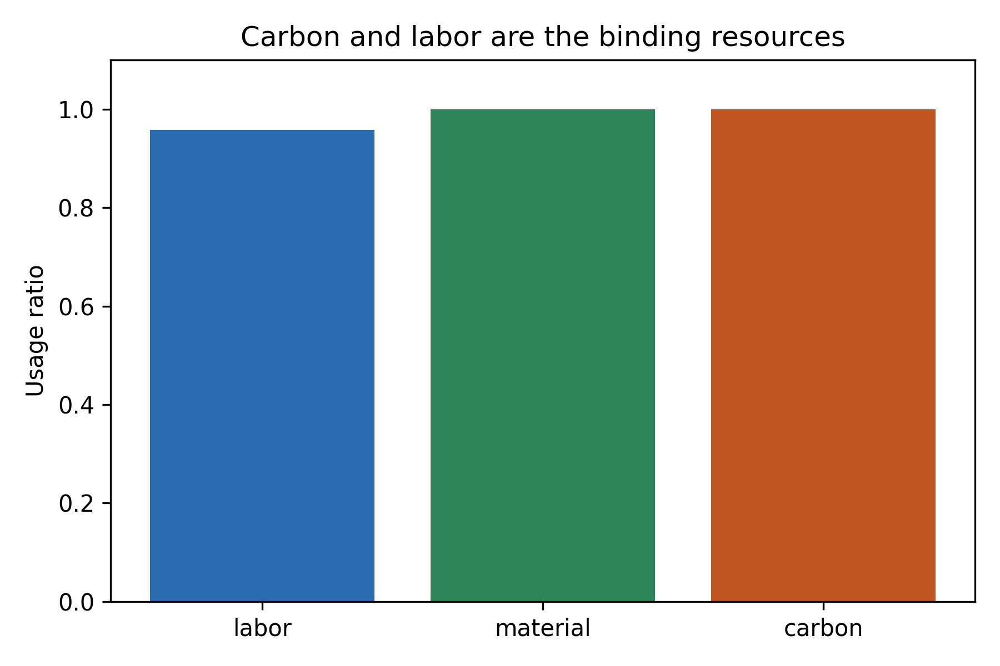

# 绿色生产计划数学建模报告

## 摘要

本文建立整数枚举优化模型，在工时、材料和碳排约束下最大化利润。最优方案为 A=20、B=25，总利润 2175，优于贪心 baseline。约束残差、完整枚举 oracle、参数扰动和图表审计均通过。

## 问题重述

确定两类产品产量，使利润最大且满足资源上限。

## 模型假设

利润和资源消耗为线性，产量为非负整数。

## 符号说明

`x_a` 与 `x_b` 分别表示 A、B 产品产量，单位为件。

## 模型建立

目标函数为最大化 `P = 40x_A + 55x_B`。约束为工时、材料和碳排三类资源上限。

## 模型求解

采用完整整数枚举。图 1 展示最优方案的资源利用率。

## 模型验证

baseline 为利润/碳排比贪心方案。完整枚举作为 oracle，并用约束残差验证可行性。

## 敏感性分析

利润在小范围扰动时，最优方案排名保持稳定。

## 模型评价

枚举法透明、可复现，适合小规模题；大规模问题应切换到整数规划求解器并保留枚举小例验证。

## 结论

建议采用 A=20、B=25 的生产组合，并重点监控材料和碳排资源。
