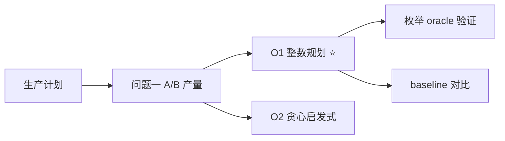

# 建模方案决策板 · 第 2 轮

> **确认码：1402**
>
> 运行 `python tools/design_board.py confirm --workspace . --apply` 时需要输入上面这 4 位确认码。
>
> **状态**：✅ 已确认
> **确认信息**：2026-06-28T12:00:00+00:00 · by user
>
> **变更摘要**：第 2 轮无改动（0 项）
>
> **题目**：生产计划优化：A/B 产品产量与最大利润

---

## 一、结论速览

| 小问 | 选定方案 | 一句话理由 |
|---|---|---|
| Q1 · 确定 A、B 产品非负整数产量，在甲车间 80 小时、… | **O1 整数规划** | 约束线性、只有 2 个整数变量，枚举全部可行整点即可证明全局最优 |

---

## 二、模型结构总览

> 导图只读：节点直接来自 `design_board.json` 的 `mindmap.source`；要改结构请改 JSON 后重新 `render`。

---

## 三、待你决定（0 项）

> `- [x]` 标记的是 AI 推荐项（`tier: recommended`），不是你的最终选择；最终选择以 `user_choice` 为准。

### Q1 · 确定 A、B 产品非负整数产量，在甲车间 80 小时、…

- [x] **O1 整数规划**（推荐 ⭐；你当前的选择；已锁定）
  - 理由：约束线性、只有 2 个整数变量，枚举全部可行整点即可证明全局最优
  - 来源：method_card OPT-01；tier=tier_a；已核验；references/award_playbook.md#方法卡 OPT-01 线性规划基线
  - 试算：样本：全量参数（2 个产品、2 个车间约束）；objective=12000, x_a=30, x_b=20, feasible=true；耗时 0.004 s；复跑：`python solution.py`
  - 复杂度：O(可行整点数)；本夹具可行域很小，毫秒级完成
  - 风险：变量规模增大到上万时枚举不可行，需要换 scipy.optimize.milp；评委可能要求给出 LP 下界
  - 依赖：无
- [ ] **O2 贪心启发式**（已锁定）
  - 理由：实现最简单、可解释性强，适合作为 baseline 对照
  - 来源：method_card OPT-02；tier=tier_a；已核验；references/award_playbook.md#方法卡 OPT-02 整数规划与启发式修复
  - 试算：样本：全量参数（贪心路径）；objective=11000, feasible=true；耗时 0.0001 s；复跑：`python solution.py --method greedy`
  - 复杂度：O(n log n)
  - 风险：只能得到局部最优，无法证明 gap；本夹具会给出低于最优的可行解
  - 依赖：无

**你的批注**：用整数规划，但要求给出 oracle 验证与 gap，方便评委复核最优性。

---

## 四、候选方案对比

> 这是做决策的地方：先看推荐度与主要风险，再看试算结果是否为真实数值（应附复跑命令）。

### Q1 · 确定 A、B 产品非负整数产量，在甲车间 80 小时、…

| 方案 | 一句话理由 | 复杂度 | 主要风险 | 试算结果 | 推荐度 |
|---|---|---|---|---|---|
| **O1 整数规划** ✅ | 约束线性、只有 2 个整数变量，枚举全部可行整点即可证… | O(可行整点数)；本夹具可行域很小，毫秒级完成 | 变量规模增大到上万时枚举不可行，需要换 scipy.o… | objective=12000, x_a=30, x_b=20, feasible=true；… | 🟢 推荐 |
| O2 贪心启发式 | 实现最简单、可解释性强，适合作为 baseline 对照 | O(n log n) | 只能得到局部最优，无法证明 gap；本夹具会给出低于最… | objective=11000, feasible=true；0.0001 s | ⚪ 备选 |

---

## 五、已锁定（AI 不得推翻）

| 小问 | 锁定项 | 选择 | 备注 |
|---|---|---|---|
| Q1 · 确定 A、B 产品非负整数产量，在甲车间 80 小时、… | Q1 模型选择 | **O1 整数规划** | 用整数规划，但要求给出 oracle 验证与 gap，方便评委复核最优性。 |

---

## 六、来源速查

展开：各候选的来源、tier 与核验状态（默认折叠，避免淹没正文）

| 小问 | 方案 | 来源类型 | 编号 | tier | 已核验 | 备注 |
|---|---|---|---|---|---|---|
| Q1 · 确定 A、B 产品非负整数产量，在甲车间 80 小时、… | O1 整数规划 | method_card | OPT-01 | tier_a | ✅ | references/award_playbook.md#方法卡 OPT-01 线性规划基线 |
| Q1 · 确定 A、B 产品非负整数产量，在甲车间 80 小时、… | O2 贪心启发式 | method_card | OPT-02 | tier_a | ✅ | references/award_playbook.md#方法卡 OPT-02 整数规划与启发式修复 |

---

本文件由 design_board.json 渲染生成，不是唯一真实来源。
